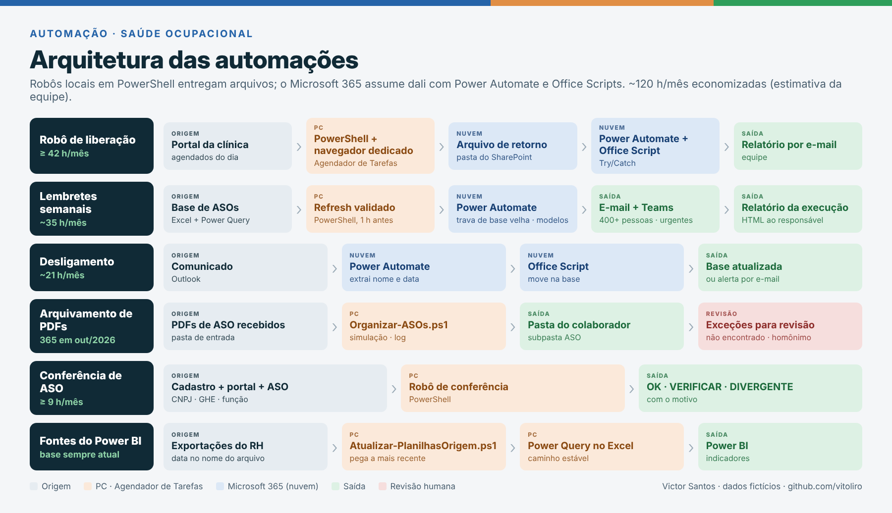
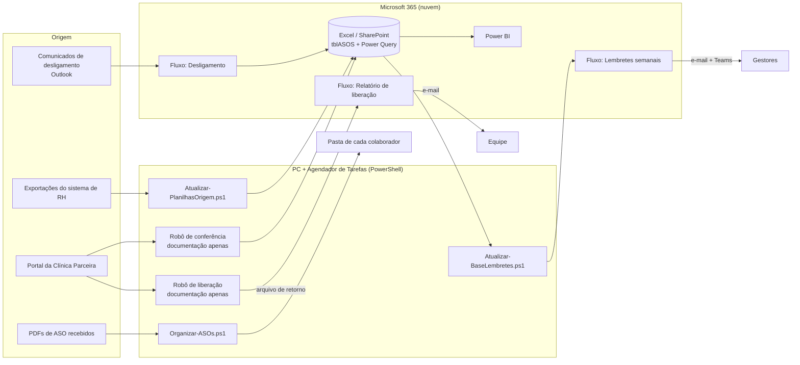

# Automação de rotinas de Saúde Ocupacional · Microsoft 365 + PowerShell

> Portfólio com **dados e caminhos fictícios** (Empresa Alfa, Empresa Beta, Clínica Parceira).
> Os processos e a lógica são reais; nomes, pastas, e-mails e CPFs foram substituídos.
> Painéis em Power BI do mesmo projeto: [powerbi-saude-ocupacional](https://github.com/vitoliro/powerbi-saude-ocupacional)

## O problema

O controle de ASOs de cerca de 2.900 colaboradores dependia de rotinas manuais:

- consultar todo dia, no portal da clínica, quem foi atendido e se o ASO foi liberado;
- cobrar gestores de ASOs vencidos e a vencer;
- tirar desligados da base;
- arquivar PDFs na pasta de cada pessoa;
- conferir se CNPJ, GHE e função do ASO batiam com o cadastro.

## O que foi construído (projeto individual)

| Automação | Tecnologia | Frequência | Economia | Detalhes |
|---|---|---|---|---|
| Robô de liberação + relatório por e-mail | PowerShell + navegador dedicado + Power Query + Power Automate + Office Script | diária | ≥ 42 h/mês | [robo-liberacao.md](docs/robo-liberacao.md) |
| Lembretes de ASO vencido/a vencer (e-mail + Teams) | Power Automate + PowerShell (refresh) | semanal | ~35 h/mês | [fluxos](docs/fluxos-power-automate.md#1-lembretes-de-aso--semanal) |
| Fluxo de desligamento | Power Automate (Outlook) + Office Script | por evento (~5/dia) | ~21 h/mês | [fluxos](docs/fluxos-power-automate.md#2-fluxo-de-desligamento) |
| Organização dos PDFs de ASO nas pastas | PowerShell | diária | ~12–18 h/mês (**365 PDFs em out/2026, medido**) | [script](scripts/Organizar-ASOs.ps1) |
| Conferência de novos funcionários (CNPJ, GHE, função × ASO) | PowerShell + navegador dedicado + Power Query | por lote | ≥ 9 h/mês | [robo-conferencia.md](docs/robo-conferencia.md) |
| **Total** | | | **~120 h/mês** | [método](docs/metodo-economia.md) |

A economia é calculada como volume × tempo manual por item antes da automação. Os tempos são estimativa da equipe; o volume de PDFs vem do log da própria automação. O método completo está em [docs/metodo-economia.md](docs/metodo-economia.md).

## Arquitetura



<details>
<summary>Mesmo desenho em Mermaid (texto)</summary>



</details>

## Princípios aplicados em todas as automações

- **Nunca agir com dado velho.** A base dos lembretes carrega um carimbo `ATUALIZADO_EM`. O script só salva se o carimbo mudou, e o fluxo não envia nada se o carimbo não for do dia.
- **Nada se perde.** Arquivo sem destino vai para `_NAO_ENCONTRADO` ou `_AMBIGUO`. Nenhum arquivo é sobrescrito.
- **Modo simulação.** Os scripts aceitam `-DryRun`, que mostra tudo o que fariam sem alterar nada.
- **Rastreabilidade.** Cada execução grava log em CSV ou log diário, com início, fim, status e motivo do erro.
- **Leitura por nome de coluna, nunca por posição.** Se alguém reordena as colunas, nada quebra. Se uma coluna obrigatória some, o script para com um erro claro.
- **Travas de segurança.** Há limite de fila e pausa entre consultas, tempo limite e parada imediata se a sessão no portal cair.
- **Desacoplamento PC ↔ nuvem.** Os robôs locais entregam um arquivo, e a nuvem assume dali com Try/Catch e e-mail de falha.
- **Menor exposição de dados.** O PDF do ASO é lido em memória e não é salvo, e a planilha principal nunca é escrita pelos robôs.

## Conteúdo

| Caminho | O que é |
|---|---|
| [scripts/Organizar-ASOs.ps1](scripts/Organizar-ASOs.ps1) | Distribui os PDFs para `Colaborador\ASO`, com normalização de nomes, tratamento de homônimos e relatório acumulativo |
| [scripts/Atualizar-PlanilhasOrigem.ps1](scripts/Atualizar-PlanilhasOrigem.ps1) | Mantém o Power Query sempre apontando para a exportação mais recente, identificada pela data no nome do arquivo |
| [scripts/Atualizar-BaseLembretes.ps1](scripts/Atualizar-BaseLembretes.ps1) | Atualiza o Power Query (Excel via COM) antes do fluxo de lembretes, com validação dupla |
| [exemplos/Criar-AmbienteDemo.ps1](exemplos/Criar-AmbienteDemo.ps1) | Cria um ambiente fictício em `C:\Demo` para testar os scripts |
| [exemplos/log_robo_conferencia_DEMO.log](exemplos/log_robo_conferencia_DEMO.log) | Exemplo de log do robô de conferência |
| [exemplos/conferencia_DEMO.csv](exemplos/conferencia_DEMO.csv) | Exemplo de saída da conferência (planilha × clínica × ASO) |
| [docs/robo-liberacao.md](docs/robo-liberacao.md) | Robô de liberação e relatório automático por e-mail (sem código) |
| [docs/robo-conferencia.md](docs/robo-conferencia.md) | Robô de conferência de dados do ASO (sem código) |
| [docs/fluxos-power-automate.md](docs/fluxos-power-automate.md) | Desenho dos três fluxos de nuvem |
| [docs/metodo-economia.md](docs/metodo-economia.md) | Cálculo da economia de horas e números reais do log |
| [docs/arquitetura.png](docs/arquitetura.png) | Diagrama de arquitetura em imagem |

## Por que os robôs não têm código aqui

Eles operam o portal de um fornecedor com credenciais da empresa. Publicar o código exporia a estrutura do sistema de um terceiro. Por isso, estão documentados só com arquitetura, regras e exemplos fictícios.

## Como testar (Windows)

```powershell
cd "$HOME\Downloads\automacao-saude-ocupacional"
Get-ChildItem -Recurse *.ps1 | Unblock-File
powershell -ExecutionPolicy Bypass -File .\exemplos\Criar-AmbienteDemo.ps1
powershell -ExecutionPolicy Bypass -File .\scripts\Organizar-ASOs.ps1 -DryRun
powershell -ExecutionPolicy Bypass -File .\scripts\Organizar-ASOs.ps1
powershell -ExecutionPolicy Bypass -File .\scripts\Atualizar-PlanilhasOrigem.ps1 -DryRun
```

Resultado esperado no `Organizar-ASOs.ps1`: 4 movidos, 1 ambíguo e 1 não encontrado. Tudo acontece dentro de `C:\Demo`, que pode ser apagada depois.

## Próximos passos (limitações conhecidas)

- **Dependência de PC ligado.** Os scripts rodam pelo Agendador de Tarefas. O próximo passo é levar o refresh para a nuvem (Office Scripts, ou um dataflow com o Power BI Service).
- **Casamento por nome.** Em set–out/2026, o log mostrou um salto de exceções. A investigação apontou a causa na origem: PDFs nomeados fora do padrão por quem os salvava. O script separou cada um para conferência e não arquivou nenhum no lugar errado. O próximo passo é o PDF chegar identificado por CPF, uma chave estável que não depende de digitação.
