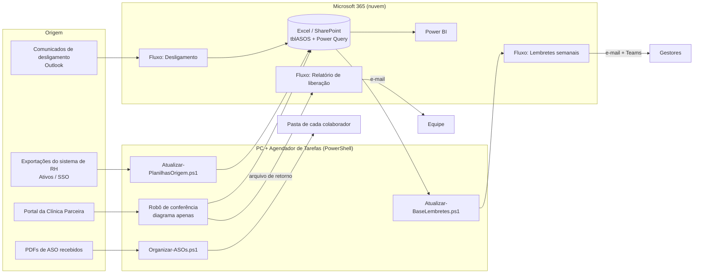

# Automação de rotinas de Saúde Ocupacional (SSO) · Microsoft 365 + PowerShell

> Portfólio com **dados e caminhos fictícios** (Empresa Alfa, Empresa Beta, Clínica Parceira).
> Os processos e a lógica são reais; nomes, pastas, e-mails e CPFs foram substituídos.
> Painéis em Power BI do mesmo projeto: [portfolio-sso-powerbi](https://github.com/vitoliro/portfolio-sso-powerbi)

## O problema

O controle de ASOs de cerca de 2.900 colaboradores dependia de rotinas manuais:

- conferir no portal da clínica quem já tinha sido atendido;
- cobrar gestores de ASOs vencidos e a vencer;
- tirar desligados da base;
- arquivar PDFs na pasta de cada pessoa;
- conferir se CNPJ, GHE e função do ASO batiam com o cadastro.

## O que foi construído (projeto individual)

| Automação | Tecnologia | Frequência | Economia estimada* |
|---|---|---|---|
| Conferência de ASOs liberados pela clínica | PowerShell + navegador dedicado + Power Query + Power Automate | diária | ≥ 42 h/mês |
| Lembretes de ASO vencido/a vencer (e-mail + Teams) | Power Automate + PowerShell (refresh) | semanal | ~35 h/mês |
| Fluxo de desligamento | Power Automate (Outlook → Excel Online) | por evento (~5/dia) | ~21 h/mês |
| Organização dos PDFs de ASO nas pastas | PowerShell | diária | ~16–20 h/mês |
| Conferência de novos funcionários (CNPJ, GHE, função) | PowerShell + Power Query | por lote | ≥ 9 h/mês |
| **Total** | | | **~120 h/mês** |

\* Estimativa da equipe: volume do mês × tempo manual por item, antes da automação. Não é medição de ponto. O método está em [docs/metodo-economia.md](docs/metodo-economia.md).

## Arquitetura



## Princípios aplicados em todas as automações

- **Nunca agir com dado velho.** A base dos lembretes carrega um carimbo `ATUALIZADO_EM`. O script só salva se o carimbo mudou, e o fluxo não envia nada se o carimbo não for do dia.
- **Nada se perde.** Arquivo sem destino vai para `_NAO_ENCONTRADO` ou `_AMBIGUO`. Nenhum arquivo é sobrescrito.
- **Modo simulação.** Os scripts aceitam `-DryRun`, que mostra tudo o que fariam sem alterar nada.
- **Rastreabilidade.** Cada execução grava um log em CSV ou um log diário, com início, fim, status e motivo do erro.
- **Leitura por nome de coluna, nunca por posição.** Se alguém reordena as colunas, nada quebra. Se uma coluna obrigatória some, o script para com um erro claro.
- **Travas de segurança.** O robô para se a fila passar de 300 pessoas, faz pausa entre consultas e interrompe tudo se a sessão no portal cair.
- **Menor exposição de dados.** O PDF do ASO é lido em memória e não é salvo, e a planilha principal nunca é escrita pelo robô.

## Conteúdo

| Caminho | O que é |
|---|---|
| `scripts/Organizar-ASOs.ps1` | Distribui os PDFs para `Colaborador\ASO`, com normalização de nomes, tratamento de homônimos e relatório acumulativo |
| `scripts/Atualizar-PlanilhasOrigem.ps1` | Mantém o Power Query sempre apontando para a exportação mais recente, identificada pela data no nome do arquivo |
| `scripts/Atualizar-BaseLembretes.ps1` | Atualiza o Power Query (Excel via COM) antes do fluxo de lembretes, com validação dupla |
| `exemplos/Criar-AmbienteDemo.ps1` | Cria um ambiente fictício em `C:\Demo` para testar os scripts |
| `exemplos/log_robo_conferencia_DEMO.log` | Exemplo de log do robô de conferência |
| `exemplos/conferencia_DEMO.csv` | Exemplo de saída da conferência (planilha × clínica × ASO) |
| `docs/robo-conferencia.md` | Como o robô de conferência funciona (sem código) |
| `docs/fluxos-power-automate.md` | Desenho dos fluxos de nuvem |
| `docs/metodo-economia.md` | Como a economia de horas foi estimada |

## Por que o robô de conferência não tem código aqui

Ele opera o portal de um fornecedor com credenciais da empresa. Publicar o código exporia a estrutura do sistema de um terceiro. Por isso, ele está documentado só com arquitetura, regras de comparação e um log fictício.

## Como testar

```powershell
.\exemplos\Criar-AmbienteDemo.ps1
.\scripts\Organizar-ASOs.ps1 -DryRun
.\scripts\Organizar-ASOs.ps1
.\scripts\Atualizar-PlanilhasOrigem.ps1 -DryRun
```

Resultado esperado no `Organizar-ASOs.ps1`: 4 movidos, 1 ambíguo e 1 não encontrado.

## Próximos passos (limitações conhecidas)

- Os scripts dependem de um PC ligado com o Agendador de Tarefas. O próximo passo é levar o refresh para a nuvem (Office Scripts, ou um dataflow com o Power BI Service) e eliminar essa dependência.
- O casamento pelo nome do arquivo é frágil para homônimos. O ideal é o PDF chegar nomeado com um identificador estável.
