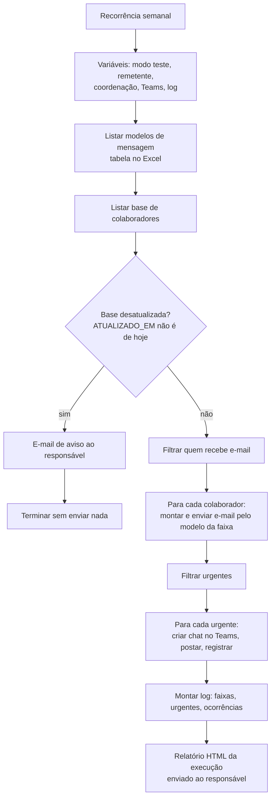
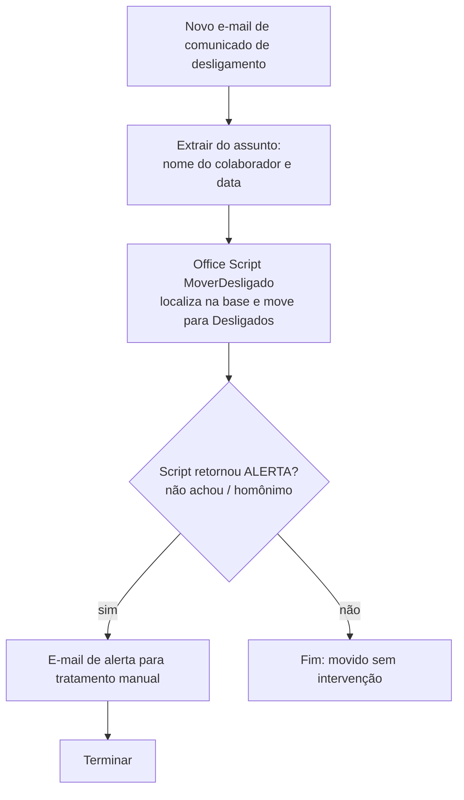
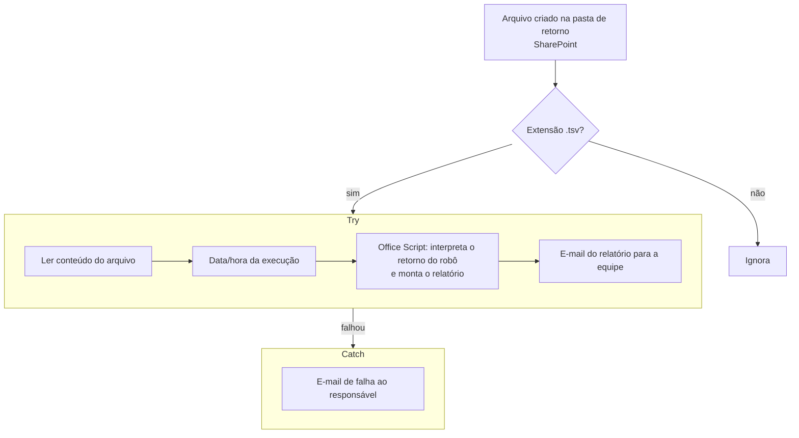

# Fluxos de nuvem (Power Automate)

Os três fluxos usam apenas conectores padrão: Excel Online, SharePoint, Outlook e Teams. Nenhum exige licença premium. A lógica pesada fica em Office Scripts, chamados pelo conector Excel Online.

---

## 1. Lembretes de ASO – semanal

| Decisão de projeto | Por quê |
|---|---|
| Modelos de mensagem numa tabela do Excel | O texto de cada faixa (vencido, vence em 30 dias…) muda sem editar o fluxo |
| Trava de base desatualizada | Se o refresh das 11 h falhar, ninguém recebe cobrança errada |
| Modo teste por variável | Valida mudanças mandando tudo só para o autor |
| Teams só para urgentes | Canal mais intrusivo reservado para os casos críticos, evitando fadiga de alerta |
| Relatório HTML ao final | Prova de execução: quantos e-mails saíram por faixa, quantos urgentes e quais ocorrências |

Histórico: execuções semanais com êxito, de 15 a 40 minutos cada, sem ninguém acompanhando.

---

## 2. Fluxo de desligamento

O fluxo trata por e-mail cada desligamento comunicado, cerca de 5 por dia. Os casos ambíguos não são resolvidos no chute: viram alerta para tratamento manual.

---

## 3. Relatório de liberação

O robô local grava o resultado numa pasta sincronizada, e a nuvem assume dali. O padrão Try/Catch garante que uma falha nunca passe em silêncio.
