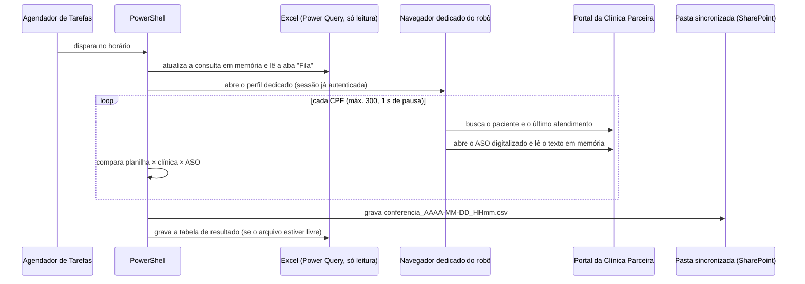

# Robô de conferência de ASO (documentação sem código)

## Objetivo

Para cada colaborador sem "ÚLTIMO ASO" na base, o robô descobre se ele já foi atendido pela clínica. Se foi, confere se o ASO emitido bate com o cadastro interno.

## Fluxo

## Regras de comparação

| Campo | Regra |
|---|---|
| Texto (GHE, função) | Normaliza acentos, maiúsculas e pontuação. Iguais → IGUAL. Mesmo código "GHE nn" → IGUAL. Um contém o outro → VERIFICAR (parcial). |
| CNPJ | Igual → IGUAL. CNPJ do ASO com dígito verificador inválido e até 2 dígitos diferentes → PROVÁVEL IGUAL (erro de OCR). |
| Datas | ASO digitalizado diferente do último atendimento → pendência "ainda não digitalizado?". Atendimento mais de 90 dias antes da admissão → "vínculo anterior?". |
| Assinatura | Assinatura em branco → DIVERGENTE. Assinatura duvidosa → VERIFICAR. |
| Situação final | DIVERGENTE > VERIFICAR > OK |

## Tratamento de erros

- Se a sessão no portal cair, o robô para tudo e avisa na tela. Ele não continua gerando "não encontrado" falso.
- Se der erro num CPF, aquela linha fica marcada como ERRO e o robô segue para o próximo.
- Se o robô parar no meio, o que já foi conferido é gravado do mesmo jeito, num bloco `finally`.
- Se a planilha estiver aberta por outra pessoa, o resultado fica garantido no CSV e o robô avisa.

Exemplos de saída: [../exemplos/log_robo_conferencia_DEMO.log](../exemplos/log_robo_conferencia_DEMO.log) e [../exemplos/conferencia_DEMO.csv](../exemplos/conferencia_DEMO.csv).
