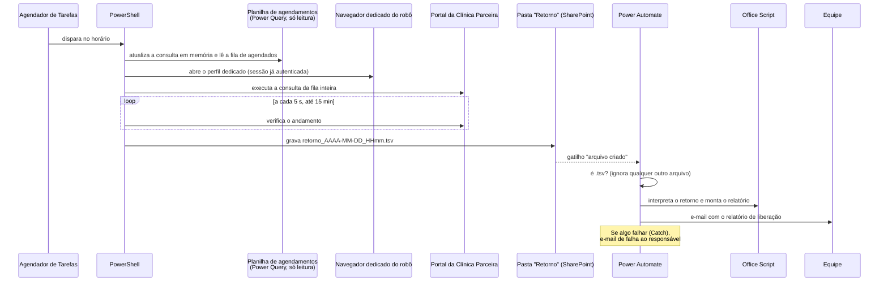

# Robô de liberação + relatório automático (documentação sem código)

## O problema

Todo dia alguém precisava abrir o portal da clínica e consultar, um a um, os colaboradores com exame agendado. Para cada um, era preciso saber se foi atendido e se o ASO já tinha sido liberado. Depois, o resultado virava um e-mail para a equipe. Isso tomava mais de 2 horas por dia de um colaborador.

## A solução: robô local + fluxo de nuvem

## Por que dividir entre PC e nuvem

| Parte | Onde roda | Motivo |
|---|---|---|
| Atualizar o Power Query | PC (Excel via COM) | O conector Excel Online do Power Automate não executa Power Query |
| Consultar o portal | PC (navegador dedicado) | O portal só funciona com sessão autenticada no navegador |
| Montar e enviar o relatório | Nuvem (Power Automate + Office Script) | Funciona mesmo que o PC desligue logo depois; o histórico de execuções fica no Power Automate |

A ponte entre as duas partes é um **arquivo** numa pasta sincronizada. Esse desacoplamento traz duas vantagens:
- se o fluxo falhar, o arquivo continua lá e pode ser reprocessado;
- se o robô falhar, nenhum e-mail sai com dado parcial.

## O que o relatório traz

- a situação de cada colaborador agendado no portal (atendido ou pendente);
- os agendamentos com data já passada e sem atendimento;
- os agendamentos com data inválida na planilha, para correção na origem.

## Salvaguardas

- **A planilha nunca é salva pelo robô.** Ele só atualiza a consulta em memória e lê o resultado. Assim, não há conflito com quem estiver com o arquivo aberto.
- **Fila vazia:** o robô encerra sem abrir o navegador.
- **Sessão expirada no portal:** o robô para e avisa na tela. Ele não gera relatório falso dizendo que "ninguém foi atendido".
- **Tempo limite** de 15 minutos para a consulta. Se ela não concluir, nenhum arquivo é gravado.
- **Colunas lidas por nome:** se uma coluna obrigatória sumir, o robô para com uma mensagem clara.
- **Log diário** em arquivo, com cada etapa e o erro, quando houver.
- **Try/Catch no fluxo:** qualquer falha na nuvem vira e-mail para o responsável.

## Resultado

A consulta diária, que levava mais de 2 horas de um colaborador, passou a rodar sozinha. A equipe recebe o relatório pronto por e-mail. A economia estimada pela equipe é de **≥ 42 h/mês**; o método está em [metodo-economia.md](metodo-economia.md).

> O código do robô não é publicado: ele opera o portal de um fornecedor com credenciais da empresa.
